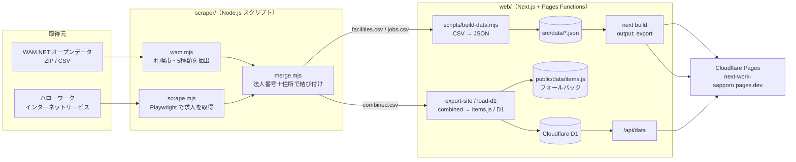

# 設計書：next work 札幌

| 項目 | 内容 |
|---|---|
| 文書の版 | 2.0 |
| 作成日 | 2026-11-20 |
| 関連文書 | [要件定義書](./requirements.md)、[README](../../README.md)、[コーディング規約](../.cursor/rules/coding-standards.mdc) |

---

## 1. 全体の構成

データ集め（`scraper/`）とサイト本体（`web/`）を分けている。
サイトは**ビルド時にデータを取り込み**、実行時に外部へデータを取りに行かない。



| 段階 | コマンド | 入力 | 出力 |
|---|---|---|---|
| 1 | `node wam.mjs` | `scraper/data/wam/<版>/<番号>/*.csv` | `scraper/output/raw/wam_sapporo.csv` |
| 2 | `node scrape.mjs` | ハローワークの検索画面 | `scraper/output/raw/hellowork_jobs.csv` |
| 3 | `node merge.mjs` | 1・2 の出力 | `scraper/output/facilities.csv`・`jobs.csv`・`combined.csv` |
| 4 | `npm run data`（web） | 3 の CSV | `src/data/*.json` と `public/data/items.js` |
| 5 | `npm run data:d1`（web） | 3 の CSV | Cloudflare D1（`items` / `meta`） |
| 6 | `npm run deploy`（web） | `out/` ＋ `functions/` | Cloudflare Pages（https://next-work-sapporo.pages.dev） |

## 2. ディレクトリ構成（web/）

```
web/
├─ docs/                  … 要件定義書・設計書（この文書）
├─ .cursor/rules/         … AI・開発者向けのルール（コーディング・テスト・Git など）
├─ scripts/
│   ├─ build-data.mjs     … scraper の CSV をサイト用 JSON に変換（ファイルの読み書き）
│   └─ lib/convert.mjs    … 変換の中身（テストできるよう分けている）
├─ tests/
│   ├─ unit/              … ../scraper/lib の単体テスト
│   ├─ integration/       … 結合テスト（ページの描画、CSV → JSON の通し）
│   └─ e2e/               … 総合テスト（Playwright）
├─ vitest.config.mts      … 単体・結合テストの設定
├─ playwright.config.ts   … 総合テストの設定
├─ public/
│   ├─ assets/css/style.css … site と同じデザイン（白〜ピンク）
│   ├─ assets/js/           … common.js / search.js / mypage.js
│   └─ data/items.js        … ローカル用フォールバック（手で編集しない）
├─ functions/api/data.ts  … GET /api/data（D1 → NW_DATA 形）
├─ migrations/            … D1 スキーマ
├─ src/
│   ├─ app/               … ページ（App Router）
│   │   ├─ layout.tsx     … フォント・CSS・背景
│   │   ├─ page.tsx       … さがす（/）
│   │   └─ mypage/page.tsx … マイページ
│   ├─ components/        … ヘッダー・フッター・モーダル枠・SiteScripts
│   ├─ lib/data.ts        … 旧 JSON 用の型・検索（変換テスト用）
│   └─ data/              … build-data.mjs が作る JSON
├─ next.config.ts
├─ open-next.config.ts
└─ wrangler.jsonc
```

## 3. データモデル

型の正本は [`src/lib/data.ts`](../src/lib/data.ts)。

### 3.1 Facility（事業所）

WAM NET の1行（＝1事業所×1サービス）に対応する。多機能型の事業所は、サービスごとに別の行になる。

| 項目 | 型 | 元の列（WAM NET） | 説明 |
|---|---|---|---|
| `id` | string | NO（システム内の固有の番号） | URL に使う（`/facilities/{id}`） |
| `service` | `"sentaku" \| "ikou" \| "a" \| "b" \| "teichaku"` | サービス種別 | 表示名は `SERVICES` で引く |
| `name` / `kana` | string | 事業所の名称／かな | |
| `corpName` / `corpNo` | string | 法人の名称／法人番号 | 法人番号は空欄のことがある |
| `ward` | string | 事業所住所（市区町村）から抽出 | 例：`中央区` |
| `address` | string | 事業所住所（市区町村＋番地以降） | |
| `tel` / `fax` / `url` | string | 事業所電話番号ほか | |
| `lat` / `lng` | number \| null | 事業所緯度／経度 | 地図リンクに使う |
| `hours` | object | 利用可能な時間帯（平日・土曜・日曜・祝日） | |
| `closed` / `hoursNote` | string | 定休日／利用可能曜日特記事項 | |
| `capacity` | number \| null | 定員 | |
| `jobIds` | string[] | （結び付けの結果） | 結び付いた求人の求人番号 |

### 3.2 Job（求人）

ハローワークの求人1件に対応する。主な項目は `id`（求人番号）、`title`（職種）、`description`（仕事の内容）、
`isA`（「就労継続支援A型事業所：該当」か）、`wage`、`hours`、`holidays`、`expiresAt`（紹介期限日）、
`url`（求人票の URL）、`facilityId`（結び付いた事業所。なければ `null`）、`match`（結び付けの確かさ）。

### 3.3 文字の正規化

`build-data.mjs` で、表示用の文字列を **NFKC** でそろえる（全角英数字 `ｈｉｂｉｎｏ` → `hibino` など）。
WAM NET の CSV が改行を `（改行）` に置き換えているので、本当の改行に戻す。

## 4. 事業所と求人の結び付け

処理は `scraper/merge.mjs`。1つの求人について、上から順に試して最初に当たったものを採用する。

| 順 | 方法 | 条件 | `match` の値 |
|---|---|---|---|
| 1 | 住所 | 法人番号が同じ事業所のうち、住所が同じもの | 住所一致 |
| 2 | 名称 | 法人番号が同じ事業所のうち、事業所名が求人の事業所名に含まれるもの | 名称が近い |
| 3 | 住所＋法人名 | 全事業所のうち、住所が同じで、法人名または事業所名が含まれるもの（WAM NET 側の法人番号が空欄・誤記の場合の救済） | 住所＋法人名一致（法人番号不一致） |
| 4 | 法人内のA型 | 求人がA型で、同じ法人のA型事業所が1つだけ（施設外就労で就業場所が違う場合） | 法人内で唯一のA型事業所 |
| — | 結び付かない | 法人番号は一致するが事業所を決められない／一致しない／法人番号がない | 法人のみ一致／なし（…） |

- **住所の比較**：NFKC にそろえ、漢数字（`南七条`→`南7条`）、`丁目`・`番地`・`番`→`-`、`号`は削除し、
  建物名・階数を落として「区＋番地」まで比べる。片方が番地まで書いていない場合（`3-4` と `3-4-1`）も、
  短い方に数字が2組以上あれば同じとみなす。
- **候補が複数あるとき**：求人がA型ならA型の事業所を優先する。多機能型で、A型以外に結び付いた場合も、
  同じ法人に同じ名前のA型事業所があればそちらに付け替える。
- **2026-11-19 の結果**：A型の求人178件のうち139件（78%）が結び付いた。残り39件のうち23件は事業所名が非公開の求人。

## 5. 画面とレンダリング方式

| パス | 画面 | 方式 | 理由 |
|---|---|---|---|
| `/` | さがす（検索・一覧） | SSG シェル ＋ クライアント JS | site と同じ。検索・並び替え・モーダルは `search.js` |
| `/mypage` | 気になるリスト | SSG シェル ＋ クライアント JS | 星・進捗・メモは localStorage（`mypage.js`） |

- 詳細の別 URL（`/facilities/[id]` など）は持たない。行クリックでモーダルを開く。
- 一覧データは Cloudflare D1（`items` / `meta`）を正本とし、`GET /api/data`（`functions/api/data.ts`）が `{ meta, items }` を返す。フロントは `window.NW_DATA` に代入する。
- `public/data/items.js` はフォールバックとして残す（`next dev`・API 障害時）。D1 経路のローカル確認は `npm run dev:pages`（`wrangler pages dev`）。`SiteScripts` が GSAP → データ → common → ページ JS の順に読む。

### 5.1 検索の仕様（`public/assets/js/search.js`）

- クエリ：`q`、`type`（カンマ区切り：`A`・`B`・`transition` など）、`ward`、`job`（`yes`/`no`）、`days`、`emp`、`perk`、`sort`
- 週の日数は求人の `daysMin`（週所定労働日数から抽出）と比較する。
- こだわり（通勤手当・土日休み・経験不問・マイカー・社会保険・在宅）は求人テキストから判定する。
- 一覧は「もっと見る」で追加表示（ページ送り URL ではない）。

## 6. 画面デザインとアクセシビリティ

- デザインの正本は `site/`。`public/assets/css/style.css` に同じ白〜ピンクのトークンを置く。
- フォント：Noto Sans JP・Zen Maru Gothic・Quicksand（Google Fonts）。
- 本文は 15px 基準（site 優先）。コントラスト AA のため `--ink-faint` は濃いめに調整する。
- フォーカスはピンクのリング。スキップリンクあり。件数は `aria-live`。
- `prefers-reduced-motion: reduce` のときは GSAP をほぼ即時にする（common.js）。

## 7. デプロイとキャッシュ

- Next.js の `output: "export"` で静的 HTML を `out/` に書き出し、`wrangler pages deploy` で Cloudflare Pages に公開する（`functions/` も同梱）。
- プロジェクト名は `next-work-sapporo`。本番 URL は https://next-work-sapporo.pages.dev 。
- D1 データベース名も `next-work-sapporo`（binding `DB`）。スキーマは `migrations/`。投入は `npm run data:d1`。
- ローカルで D1 を見るときは `npm run data:d1:local` のあと `npm run dev:pages`（別名 `preview`）。`next dev` は UI 用で、データは `items.js` フォールバック。

## 8. テスト方針

[テストルール](../.cursor/rules/testing.mdc)に従う。対象の目安：

| 種類 | ツール | ファイル | 対象 |
|---|---|---|---|
| 単体テスト | Vitest | `src/lib/data.test.ts` | `parseFilters`・`search`（種類・区・キーワード・求人あり）、`getFacility`・`getJob`、`mapUrl`、データの整合性（id の重複なし、jobIds と facilityId の対応） |
| | | `scripts/lib/convert.test.ts` | CSV の行 → Facility / Job の変換、文字の正規化、未知のサービス種別のエラー |
| | | `tests/unit/match.test.ts` | `../scraper/lib/match.mjs` の住所の正規化・住所の比較・結び付けの4段階（実際の表記ゆれの例） |
| 結合テスト | Vitest | `tests/integration/pages.test.tsx` | ページを実データで描画し、件数・フォーム・ページ送り・リンク・404・出典を確認 |
| | | `tests/integration/data-pipeline.test.ts` | CSV の書き出し → 読み込み → 変換の通し（BOM・カンマ・改行・引用符を含む値） |
| 総合テスト | Playwright ＋ axe | `tests/e2e/site.spec.ts` | Workers 環境（8788番）で、検索 → 事業所 → 求人の流れ、ページ送り、404、JavaScript 無効時、キーボード操作、横スクロールなし、アクセシビリティ（WCAG 2.1 AA の serious / critical がないこと）。desktop と mobile の2つの画面幅で実行 |

テストしやすくするため、結び付けの処理は `scraper/lib/match.mjs`、CSV → JSON の変換は `scripts/lib/convert.mjs` に、
ファイルの読み書きと分けて置いている。

2026-11-20 の結果：単体＋結合 79件 成功、総合 24件 成功（2件はスマホでのキーボード操作のため対象外）。
総合テストの導入時に、axe の検査で次の2つの問題が見つかり、直した（どちらも `globals.css` の基本スタイルを `@layer base` の外に書いていたことが原因）。

- ヘッダーの白いリンクが、全体のリンク色（濃い緑）で上書きされ、背景との色の差が足りなかった。
- 文中のリンクに下線がなく、色だけで見分ける状態だった。

## 9. 運用

- データ更新の手順は [README](../README.md#データを更新する) を参照。
- ハローワークの画面が変わると `scrape.mjs` が動かなくなる。主な依存箇所：
  検索画面の要素 ID（`#ID_LkjKbnRadioBtn5`・`#ID_skCheck0119011`・`#ID_searchBtn`）、
  ページ送り（`fwListNaviBtnNext`）、詳細画面の要素 ID（`#ID_sksu` など）。
- ページ送りは「現在のページ番号が次の番号になるまで待つ」ことで、途中状態でページを飛ばす問題を防いでいる。
